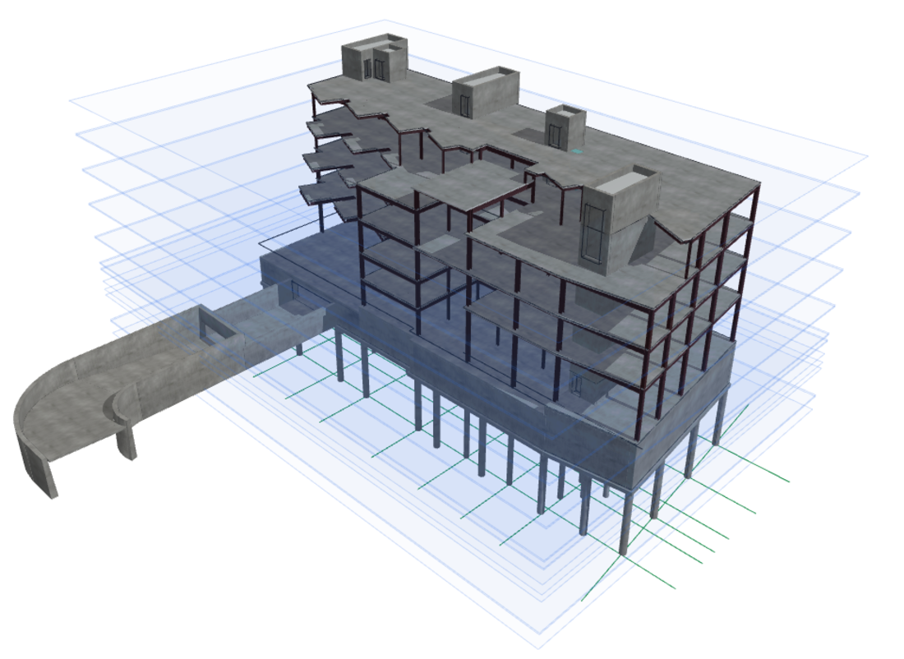
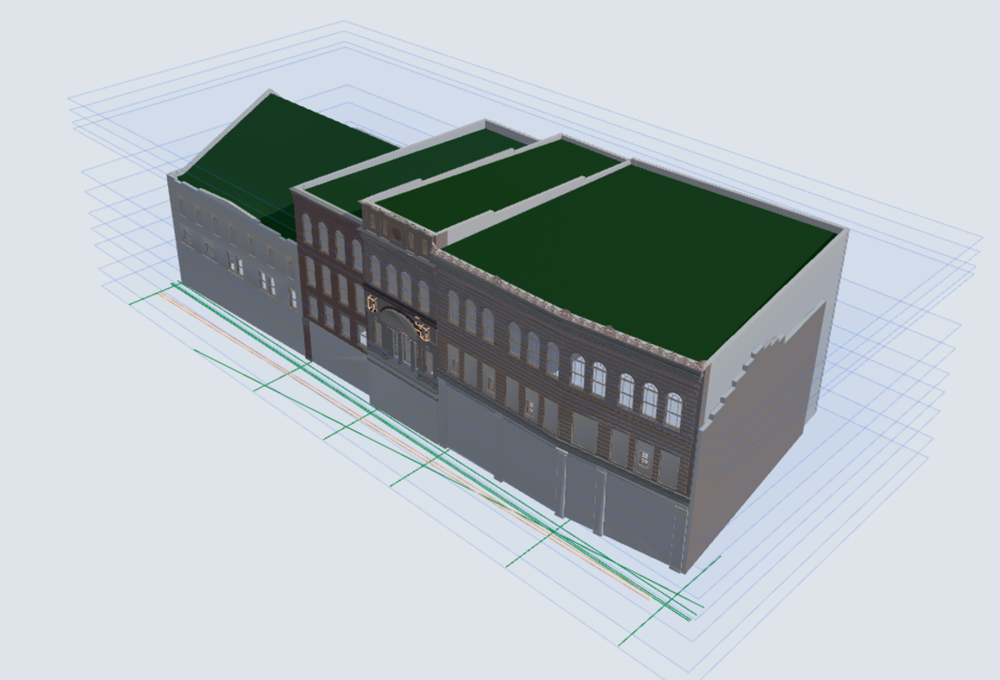
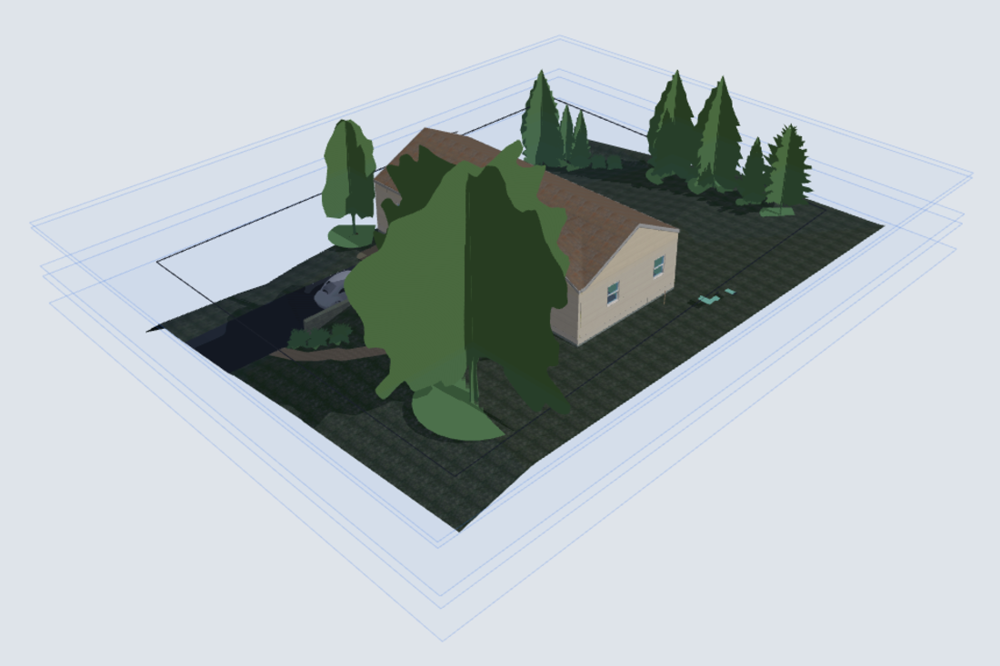

<p align="center"></p>

<h1 align="center">rvt-reader</h1>
<p align="center">Read Revit <code>.rvt</code> / <code>.rfa</code> / <code>.rte</code> files (2017-2026) without Revit.</p>

<p align="center"><a href="LICENSE"></a> </p>

## What it does

- Opens the OLE2 container, undoes the paged/gzip stream layout and parses the embedded class schema (`Formats/Latest`).
- Decodes element records: category, name, ids, stored parameters and relationships.
- Reconstructs geometry for most element classes (walls, floors, roofs, ceilings, family instances, MEP curves, rooms, toposurfaces) as meshes or B-rep surfaces.
- Extracts plain text and metadata (`rvt2text.py`), including a Recoll filter (`rvt2recoll.py`) for desktop search.

Everything is plain Python plus `olefile` (and optionally [rvt-core](https://github.com/baleti/rvt-core) for speed).

## Gallery

Everything below was decoded straight from the `.rvt` files by this reader (geometry, materials, levels and grids), then drawn with [rvt-viewer](https://github.com/baleti/rvt-viewer). No Revit was involved. The models are the standard Autodesk sample files, which are not redistributed here.

<table>
<tr>
<td width="50%"><br><sub>Snowdon Towers, structural (Revit 2024): slabs, columns, framing, curved ramp walls, levels and grids</sub></td>
<td width="50%"><br><sub>Snowdon Towers, facades (Revit 2026): masonry facades with per-face materials and arched openings</sub></td>
</tr>
<tr>
<td colspan="2" align="center"><br><sub>Residential sample project (Revit 2020): topography, roof, walls, windows, planting and site elements</sub></td>
</tr>
</table>

## Quick start

```bash
pip install olefile numpy
python rvt2text.py model.rvt          # metadata, names and text found in the file
```

The other tools in this repository import the modules here directly. Point them at a checkout with `RVT_READER_DIR=/path/to/rvt-reader`.

## Measured accuracy

Accuracy is evaluated against ground truth exported by the Revit API on a corpus of Autodesk sample projects (2017-2026). Headline numbers at the time of writing: structural coverage above 99.8% of elements for every year, geometry accuracy of 99%+ for the main classes (walls, floor/ceiling, family instances, rooms), and about 95% of 9 million parameter values reproduced exactly. Per-class, per-year tables and known gaps are in [`NOTES.md`](NOTES.md) and [`READER-STATUS.md`](READER-STATUS.md).

## Documentation

| File | Contents |
|---|---|
| [`NOTES.md`](NOTES.md) | Format findings and the running research log |
| [`GEOMETRY_API.md`](GEOMETRY_API.md) | Geometry API and fidelity tables |
| [`ACCEPTANCE.md`](ACCEPTANCE.md) | Acceptance criteria used for the accuracy measurements |
| [`PARAM_RULES_c6.md`](PARAM_RULES_c6.md) | Derived-parameter rules |
| [`RUST_INTEGRATION.md`](RUST_INTEGRATION.md) | How the Rust fast path hooks in |
| [`NOTICE`](NOTICE) | Third-party attribution |

The many small scripts in the repository root are research and evaluation tools kept for reproducibility.

## Coverage

Measured against Revit's own output (Revit API dumps) on a corpus of Autodesk sample projects. Figures are from the last full runs (2026-10-16 to 2026-10-19).

| Area | Result |
|---|---|
| Files tested | 60 projects (Revit 2020-2026) with full ground truth, plus 15 projects from 2017-2019 compared against the upgraded same-model dump |
| Structural coverage (elements found vs Revit's element list) | 2020-2023: 100.00% complete; 2024-2026: about 99.8% (the rest are elements Revit creates on load and that are not stored in the file) |
| Geometry, accurate against Revit (bbox IoU and volume) | Family instances 99.5% (14,435 placed), walls 99.3%, rooms 99.4%, ceilings / floors / profile roofs / site surfaces / MEP curves 100%, toposolids 97.6% |
| Geometry, 2017-2019 files | Family instances 99.8%, walls 99.1%, rooms 99.4%, all other classes 100% |
| Parameter values reproduced exactly | 94.9% of 8.98 million values (by year: 2020 95.4%, 2021 95.9%, 2022 95.8%, 2023 95.7%, 2024 93.9%, 2025 93.9%, 2026 92.8%) |
| Format versions parsed | Revit 2011-2026 container and schema; 14 of 14 test files fully consumed by the schema parser |

## Known gaps and pending work

- Parameters not reproduced yet (largest first): Fixture Units, MEP engine values (pressure drop, velocity, flow), Area/Volume of some MEP and curtain-wall families, Cut Length, sheet-referencing parameters, Occupancy Unit, and electrical counts. Values that cannot be derived reliably are left blank rather than guessed.
- Text3D elements: 76.9% accurate (13 elements in the corpus).
- Masses carry only zero-volume level data; exact family profile polygons are not stored in the file (documented blocker).
- Nested and void families without solids, and texture bitmaps, are not stored in the file and therefore not recovered.
- Rebar sets in files from 2023 onward are not fully covered (shape rules are proven on 2020 files).
- One 2017-2019 sample has no matching reference dump and is not evaluated.

## The rvt toolkit

| Repo | Role |
|---|---|
| [rvt-reader](https://github.com/baleti/rvt-reader) | Pure-Python reader: file container, schema, elements, parameters, geometry |
| [rvt-core](https://github.com/baleti/rvt-core) | Optional Rust acceleration for the reader (PyO3) |
| [rvt-viewer](https://github.com/baleti/rvt-viewer) | Browser 3D viewer built on the reader |
| [rvt-sheets](https://github.com/baleti/rvt-sheets) | Sheet and view renderer (2D drawings) built on the reader |
| [rvt-qa](https://github.com/baleti/rvt-qa) | Visual-diff QA tooling for rvt-sheets output |
| [rvt-writer](https://github.com/baleti/rvt-writer) | Experimental generator of `.rvt` / `.rte` scenes |

## Status and scope

Research-grade software developed by reverse-engineering the file format through black-box analysis of sample files and comparison with the output of the official Revit API. It is accurate on the files it has been tested against but makes no guarantees for arbitrary files. Test models (Autodesk sample files) and Revit-derived ground-truth data are **not** included in this repository.

## License

MIT, see [LICENSE](LICENSE). Autodesk and Revit are trademarks of Autodesk, Inc. This project is independent and is not affiliated with, endorsed by or sponsored by Autodesk.
